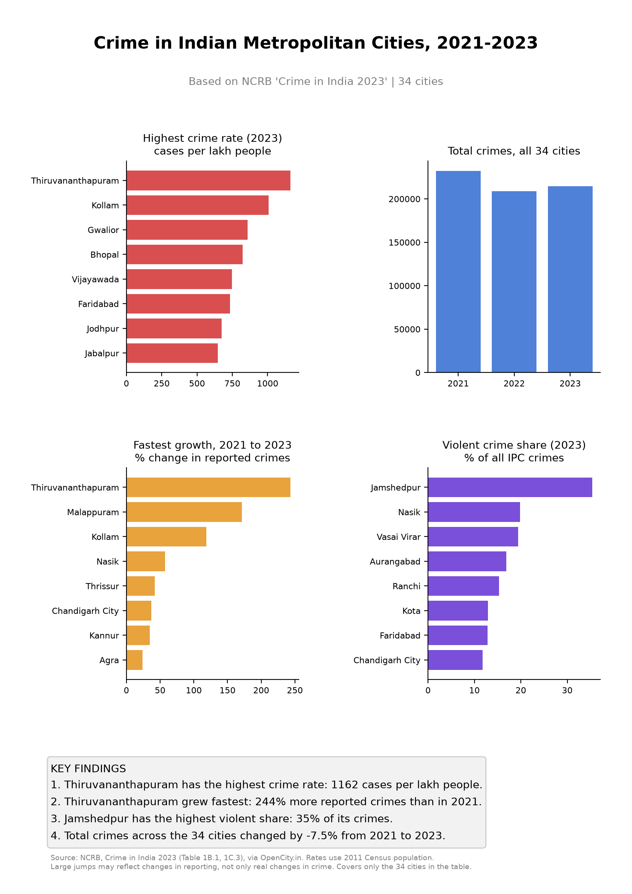

# India Metropolitan Crime Analysis (NCRB 2023)

A PySpark and SQL pipeline that turns NCRB "Crime in India 2023" PDF tables into clean data, insights, and a one-page visual report.

## Project structure
| Folder | What's inside |
|---|---|
| `1_datasets/` | `raw/` NCRB PDF tables, `processed/` cleaned CSVs and Parquet |
| `2_data_cleaning/` | PDF extraction (`extract_tables.py`) and Spark SQL cleaning and analysis (`clean_and_analyze.py`) |
| `3_visual_report/` | `make_report.py` and the one-page report (PNG and PDF) |

## Steps
1. Extract tables from the PDFs into CSV (pdfplumber)
2. Clean, join, and query the data with PySpark and Spark SQL, then save as Parquet
3. Build the one-page visual report (matplotlib)

## Tech stack
Python, PySpark, Spark SQL, Pandas, pdfplumber, Matplotlib, Parquet

## Run it
    python3.11 -m venv .venv && source .venv/bin/activate
    pip install -r requirements.txt
    python 2_data_cleaning/extract_tables.py
    python 2_data_cleaning/clean_and_analyze.py
    python 3_visual_report/make_report.py

## Data
NCRB, Crime in India 2023 (Tables 1B.1, 1B.4 and 1C.3), via OpenCity.in (public domain).
Covers the 34 metropolitan cities in the tables. Rates use 2011 Census population.

## Limitations
- Not all of India: only the cities in these tables.
- Reporting changes can cause large jumps, so they may not reflect real changes in crime.
